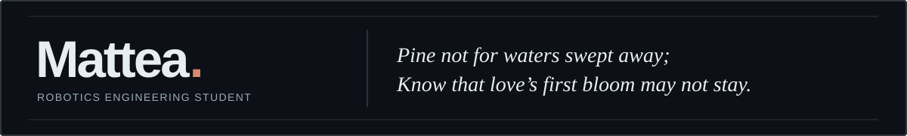

## About Me

I'm a Robotics Engineering student with a strong interest in **Computer Vision, Artificial Intelligence, and Embedded Systems**.

I enjoy exploring the intersection of software and hardware, from developing perception algorithms to deploying intelligent systems on real-world devices.

Currently learning, experimenting, and building things along the way.

## Tech Stack

**Languages**

**AI & Computer Vision**

**Robotics & Embedded Systems**

**Development Tools**

## Currently Exploring

- Robotic perception and intelligent systems
- Deep learning and edge AI deployment
- Embedded development and system integration
