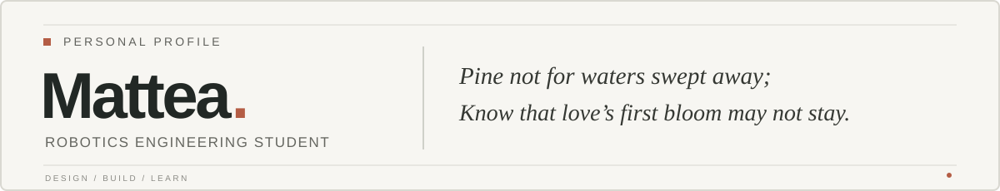
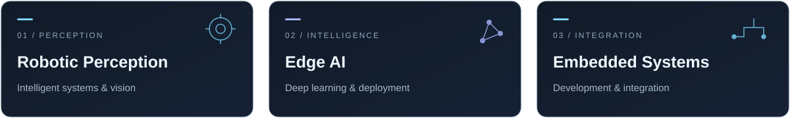

 

**Robotics Engineering Student** &nbsp;·&nbsp; **Building between software and hardware**

 

 

### `01.` About Me

I'm a Robotics Engineering student with a strong interest in **Computer Vision, Artificial Intelligence, and Embedded Systems**.

I enjoy exploring the intersection of software and hardware, from developing perception algorithms to deploying intelligent systems on real-world devices.

Currently learning, experimenting, and building things along the way.

 

### `02.` Tech Stack

LANGUAGES

AI / COMPUTER VISION

ROBOTICS / EMBEDDED

DEVELOPMENT

 

### `03.` Currently Exploring

 

  Perceive carefully. Build deliberately. Keep exploring.

